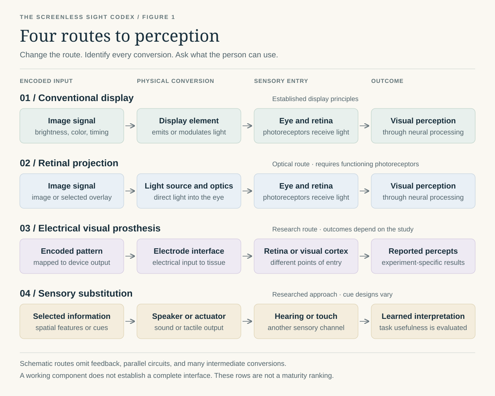

# Introduction: Beyond the Screen

[Book home](README.md) · [Contents](CONTENTS.md) · [Glossary](GLOSSARY.md)

A screen makes an invisible process visible. Electrical signals reach a
device, light changes, and a person recognizes a face, reads a sentence, or
notices something moving. Familiarity makes this sequence seem simple. The
interesting questions begin when we separate its parts.

What carries the information? What converts it into a stimulus? Where does
that stimulus enter the sensory system? And how much of the resulting
experience comes from the delivered signal, rather than what the person has
learned to recognize?

This encyclopedia follows those questions across display engineering,
sensory biology, and proposed interfaces. Its central subject is **visual
transduction**: the physical conversions that help make visual information
available to perception. Encoding and interpretation belong in the same
investigation: changing what is carried may change what the physical
interface needs to deliver. The question is how those changes meet.

## One Message, Several Routes

Consider a simple message: **there is an opening to your left**.

A conventional display could show a photograph of the opening. A wearable
display could add an arrow. A speaker could say “opening on the left.” A
tactile interface could use a learned pattern. An experimental visual
prosthesis would need to convert the relevant information into stimulation
that its user could distinguish and interpret.

The routes differ in what they preserve. A photograph may contain texture,
color, and other objects. A spoken cue preserves an interpretation of the
scene. A tactile pattern depends on an agreed code. Each route invites a
different investigation: what is conveyed, what the person contributes,
what kind of experience develops, and where an interpretation can go wrong.

The comparison gives us a useful question for every entry: **what information
survives the chain, and what might perception build from it?**

*Figure 1. Four simplified routes through the encyclopedia. Read each row from
left to right. The pathways are schematic; labels describe a route family,
not the readiness of every possible device.*

The text equivalents and limitations are in the [diagram guide](modules/12-gallery.md).

## Three Questions That Open the Map

**What can change while the message survives?** A direction can be represented
as text, a tone, or an arrow. The carrier, the code, and the receiver can each
change. Following those substitutions exposes alternatives that a screen-first
description might overlook.

**Where does a physical effect become an experience?** Light emission, a
neural response, a reported sensation, and recognition offer different
observations of the chain. Their relationship is part of the subject to be
explored. The [evidence guide](sources/evidence-guide.md) helps locate what
a result answers and what remains open.

**What does an analogy reveal, and what does it hide?** Treating a phosphene
as a pixel suggests spatial addressing. Treating it as a stroke suggests
timing. Treating it as a learned sign suggests a vocabulary. Each comparison
opens a different experiment, and each can also conceal a useful difference.

## What “Screenless” Means Here

The title groups several different possibilities. Some remove the external
viewing surface while retaining light and functioning photoreceptors.
Others bypass a damaged part of the visual pathway. Sensory substitution
routes selected information through hearing or touch. Cue systems may keep
an ordinary display and change the message instead.

These possibilities overlap. A system can combine ordinary optics with
spoken descriptions, or use a sparse code with more than one output channel.
The important comparison is what each route requires and delivers, rather
than how many familiar components it removes.

The book's phrase **“perception as the medium”** asks how far learning,
attention, and active exploration can become working parts of an interface.
Could a small physical input support an experience richer than its apparent
channel count suggests? Where would that richness come from, and how would
we distinguish learned structure from a mistaken reconstruction?

## From Explanation to Possibility

The foundation chapters begin with systems whose conversions can be
described directly. The biological chapters introduce a receiver that
transforms its input through interacting circuits. The interface chapters
then ask what happens when a device changes the point of entry or the form
of the message.

The later material explores memory, unfamiliar transducers, and speculative
architectures. Those subjects belong in the same encyclopedia because they
expose assumptions in the earlier chapters. An unresolved mechanism is a
place to investigate. Describe the strongest version of the idea, identify
the conversion it needs, and ask which observation could discriminate
between it and competing explanations.

Historical chapters add another perspective: the machines people build and
the machines people imagine influence the questions they ask. Historical
accounts are read in their own context, with their sources and uncertainties
kept visible.

## Using an Entry

Begin with the idea and follow its chain from input to experience. Read its
sources alongside its proposed extensions. Ask what the apparatus delivered,
what was measured, what the person reported, and how the explanation was
chosen. Apply the same scrutiny to an enthusiastic claim, an official
description, and an argument that the idea cannot work.

For a continuous reading path, follow the chapter navigation. For a
reference visit, use the [contents](CONTENTS.md),
[glossary](GLOSSARY.md), or [scenario index](scenarios/README.md).

**Next:** [00. Display Transduction Foundations](modules/00-display-transduction-foundations.md)
