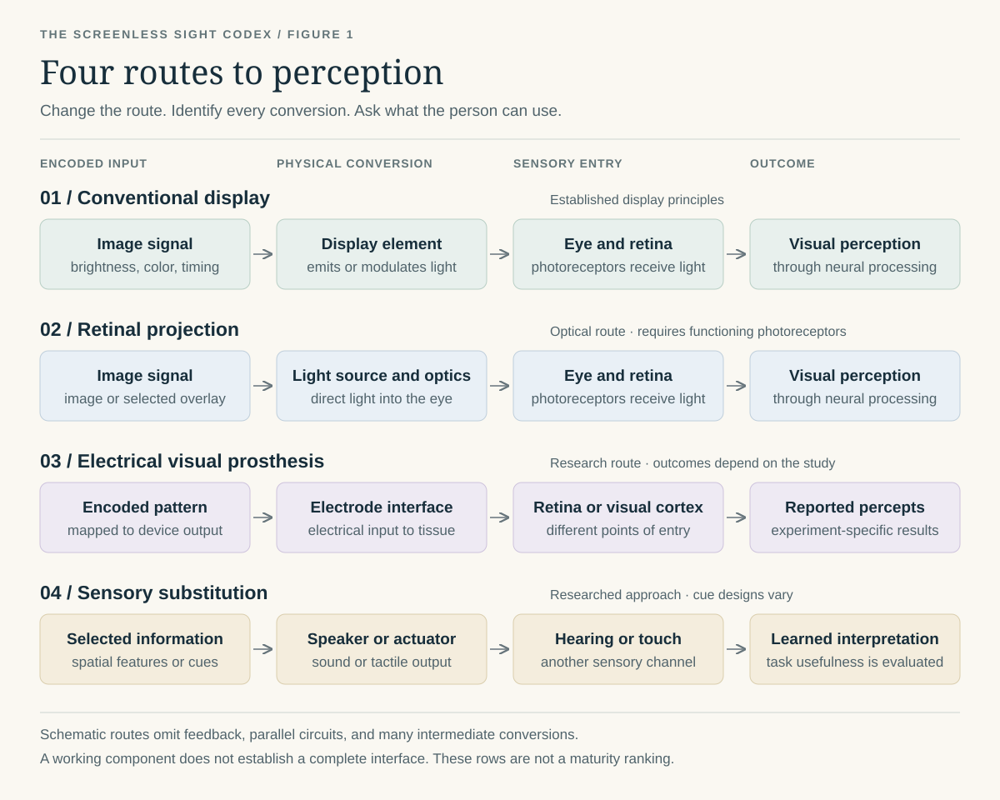

# 12. Gallery

[Book home](../README.md) · [Contents](../CONTENTS.md) · [Glossary](../GLOSSARY.md)

This module tracks images and diagram needs for the encyclopedia.

## Original Diagram: Four Routes to Perception

*Figure 1. An original schematic for this encyclopedia. Route labels distinguish
the kind of interface, not the readiness of every device in the family.*

### Text Equivalent

| Route | Simplified chain | Main distinction |
| --- | --- | --- |
| Conventional display | Image signal → light emission or modulation → eye and retina → neural processing → visual perception. | Uses a display element and functioning photoreceptors. |
| Retinal projection | Image signal → light source and projection optics → eye and retina → neural processing → visual perception. | Changes the optical arrangement while retaining photoreceptor input. |
| Electrical visual prosthesis | Encoded pattern → electrode interface → retinal or cortical tissue → reported percept. | Changes the entry point; outcomes must be read within each study. |
| Sensory substitution | Selected information → sound or tactile actuator → hearing or touch → learned interpretation. | Changes the sensory channel; useful performance requires evaluation. |

The diagram omits feedback and parallel processing. It does not represent
retina and cortex as interchangeable, or classify every optical device as
established. See [Display Physics](01-display-physics.md),
[Neural Interfaces](08-neural-interfaces.md),
[Audio-Visual Substitution](../scenarios/40-audio-visual-substitution.md),
and the [evidence guide](../sources/evidence-guide.md) for context.

### Chat Reference Images

The [chat reference gallery](../media/chat-reference-gallery.md) retains images
from the source conversation as background references. Their original attribution
and reuse permissions need to be established before using them as book figures.
The introduction uses the original diagram above.

## Needed Original Diagrams

| Diagram | Purpose |
| --- | --- |
| Display transduction chain | Show signal -> carrier -> transducer -> photons -> eye. |
| Display comparison | Compare CRT, plasma, LCD, OLED, and MicroLED routes. |
| Master transduction chain | Expand Figure 1 with feedback and repeated conversions. |
| Eye optics | Show cornea, lens, pupil, and retina. |
| Retinal layers | Show photoreceptors through ganglion cells. |
| Visual pathway | Show retina -> optic nerve -> LGN -> V1 -> higher cortex. |
| Interface points | Mark screen, eye, retina, optic nerve, LGN, cortex, memory. |
| Evidence and scope map | Distinguish demonstrated results from proposals without ranking all routes on one ladder. |
| Scenario map | Group the 57 scenario entries by carrier and target. |
| Scope map | Show where conceptual research notes, toy models, and hardware questions separate. |

## Diagram Style

- Use clean labels and arrows.
- Avoid implying that speculative routes are available technology.
- Mark established, research, proposed, speculative, and frontier concepts
  with different visual labels.
- Keep medical and neural diagrams explanatory, not procedural.
- Prefer original vector diagrams for repository longevity.

## Related Files

- [Chat Reference Gallery](../media/chat-reference-gallery.md)
- [Bibliography](../sources/bibliography.md)

---

[Previous chapter](11-safety-and-ethics.md) · [Contents](../CONTENTS.md) · [Next chapter](13-creative-engineering.md)
